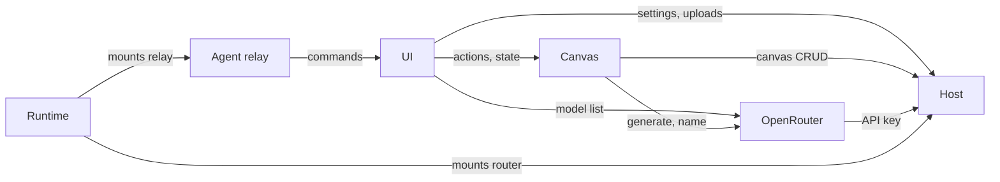
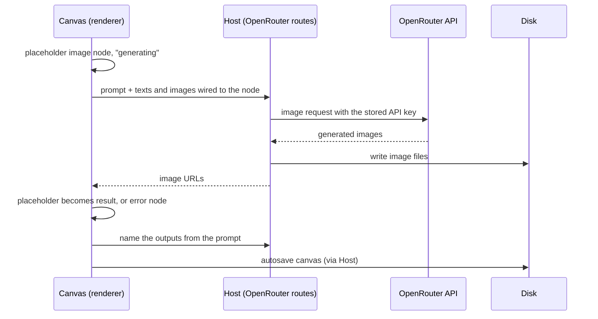

# Gallery — Overview

Infinite canvas for generating images with OpenRouter models: text nodes hold prompts, image nodes hold results, edges say which node feeds which.

## Architecture in one picture

```
 Renderer (React)  ──  HTTP /api/*  ──►  Local host (Node)  ──►  ~/.gallery/data  (JSON + images)
 canvas, nodes, stores                   one router (Request → Response)  ──►  OpenRouter  (images, names, models)
```

The renderer never touches disk or OpenRouter: everything goes through the local host. The host is the same code in every run mode (`docs/RUNTIME.md`).

## Tree

```
gallery/
├── electron/       → Electron main: window, packaged HTTP host, quit flush
├── src/
│   ├── main.tsx    → renderer entry
│   ├── components/ → React UI (canvas, nodes, sidebar, settings; shadcn in ui/)
│   ├── stores/     → zustand; canvas-store.ts is the brain of the app
│   ├── lib/        → front logic (versioning, history, generation) + database/ (Node-only, fs)
│   ├── server/     → HTTP host: router, guard, routes/ (one folder per endpoint)
│   └── hooks/, types/
├── vite.shared.ts  → dev API plugin, shared by the two Vite configs
├── forge.config.ts → Electron Forge: packaging, DMG
└── docs/           → this folder
```

## Modules

| Module      | Owns                                                                                                                      | Doc                |
| ----------- | ------------------------------------------------------------------------------------------------------------------------- | ------------------ |
| Runtime     | `electron/`, `forge.config.ts`, `vite*.ts`: how the app starts, is hosted, built, packaged                                | `docs/RUNTIME.md`  |
| Host        | `src/server/` router, guard, adapter; canvas, images, settings routes; `src/lib/database/`                                | `docs/HOST.md`     |
| OpenRouter  | OpenRouter calls: generate, name, image-models, validate-key; `src/lib/{generation,models}.ts`                            | `docs/OPENROUTER.md` |
| Canvas      | graph model, versions, mentions, undo, autosave, named actions: `src/stores/canvas-store.ts`, `src/lib/{versioning,history,subgraph,canvas-error}.ts` | `docs/CANVAS.md`   |
| Agent relay | SSE command channel to the renderer, and the catalog of commands (validated by the host, run by the renderer): `src/server/routes/agent/`, `src/lib/agent-{catalog,executors,relay}.ts`; the `gallery` shell script, `src/server/gallery.sh` | none yet           |
| UI          | `src/components/`, `src/hooks/`, settings and model stores                                                                | none               |



## Main flow: generating an image



Image bytes never travel back through the renderer: only URLs come back. What feeds a generation: `docs/CANVAS.md`; how the request is built: `docs/OPENROUTER.md`.

## Endpoints

Handlers live in `src/server/routes/<path>/route.ts`.

| Path                         | Methods            | Module      |
| ---------------------------- | ------------------ | ----------- |
| `/api/canvas`                | GET, POST          | Host        |
| `/api/canvas/:id`            | GET, PATCH, DELETE | Host        |
| `/api/images`                | POST               | Host        |
| `/api/images/:file`          | GET                | Host        |
| `/api/settings`              | GET, PATCH         | Host        |
| `/api/settings/validate-key` | POST               | OpenRouter  |
| `/api/generate`              | POST               | OpenRouter  |
| `/api/name`                  | POST               | OpenRouter  |
| `/api/image-models`          | GET                | OpenRouter  |
| `/api/agent/stream`          | GET                | Agent relay |
| `/api/agent/command`         | POST               | Agent relay |
| `/api/agent/commands`        | GET                | Agent relay |
| `/api/agent/commands/:name`  | GET                | Agent relay |
| `/api/agent/reply`           | POST               | Agent relay |

## Conventions

- Alias `@` = `src/`.
- `src/server/**` and `src/lib/database/**` use Node APIs: the renderer MUST NOT import them. Shared shapes live in `src/types/` (prefix `T`). The one `src/lib/` module the host imports is `agent-catalog.ts`: it imports zod only, so both sides can load it.
- A route is a `route.ts` exporting `GET`/`POST`/… as `(Request, { params }) → Response`. A new route = new file + one line in the `table` of `router.ts`.
- The renderer owns the open canvas; the host only stores snapshots.
- Three zustand stores in `src/stores/` (`canvasStore`, `settingsStore`, `imageModelsStore`), each with a `useXStore` hook.
- Dark theme only. No `'use client'` (Vite, not Next).
